<div align="center">

<picture>
  <source media="(prefers-color-scheme: dark)" srcset="docs/banner-dark.svg">
  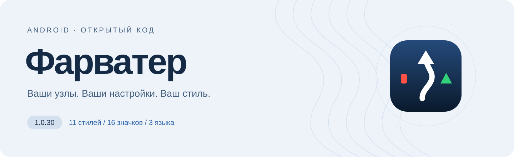
</picture>

**VPN-клиент для Android: подписки, проверка узлов и 11 стилей оформления.**

[](https://github.com/farvater-app/farvater/releases/latest) [](https://github.com/farvater-app/farvater/releases) [](#установка) [](LICENSE)

**[Скачать](https://github.com/farvater-app/farvater/releases/latest) · [Возможности](#возможности) · [Скриншоты](#скриншоты) · [Вопросы](#вопросы-и-ответы)**

<sub>Без регистрации, рекламы и аналитики. Исходный код открыт. Сервер и подписку выбираете вы.</sub>

</div>

---

## Ваше подключение — под вашим управлением

Фарватер — бесплатный клиент для подключения Android к выбранным вами серверам. Он загружает подписки, проверяет узлы и помогает управлять соединением. Подойдёт тем, у кого есть собственный сервер или подписка стороннего поставщика; можно самостоятельно выбрать и источник из публичного каталога.

**У проекта нет своей сети VPN-серверов и продажи доступа.** Серверы принадлежат сторонним владельцам, которые определяют их условия и доступность. Публичный каталог по умолчанию выключен; наличие источника в нём не означает проверки безопасности сервера. Используйте сети и серверы, к которым у вас есть право доступа, с соблюдением применимого закона.

## Возможности

<table>
<tr>
<td width="50%" valign="top"><br><strong>Выбор соединения</strong><p>Ручной выбор, поиск рабочего узла «Галс», проверка доступности и переключение при сбое.</p></td>
<td width="50%" valign="top"><br><strong>Ваши источники</strong><p>Личные подписки, публичный каталог, ссылки на отдельные узлы и поддерживаемые конфигурации Xray JSON.</p></td>
</tr>
<tr>
<td width="50%" valign="top"><br><strong>Нужные узлы рядом</strong><p>Избранное, поиск и сворачиваемые группы. Отметьте узлы звёздочкой и включите фильтр избранного.</p></td>
<td width="50%" valign="top"><br><strong>Расход по дням</strong><p>Скорость соединения и история трафика за 7 или 30 дней. Записи остаются на телефоне.</p></td>
</tr>
<tr>
<td width="50%" valign="top"><br><strong>Свой внешний вид</strong><p>11 стилей, 16 значков, русский, английский и персидский интерфейс. Настройки подключения общие для всех стилей.</p></td>
<td width="50%" valign="top"><br><strong>Приложение под рукой</strong><p>Плитка шторки, виджет и передача установленного APK. При передаче ваши подписки и настройки не добавляются в файл.</p></td>
</tr>
</table>

## Скриншоты

### Один клиент. Одиннадцать характеров.

Стиль меняет панели, кнопки, списки, переключатели и окна. Выберите его в <kbd>Настройки</kbd> → <kbd>Оформление</kbd>. Светлая и тёмная темы доступны в девяти стилях; **#РосКомПозор** и **«Ведьмин кот»** всегда тёмные. Material You на Android 12 и новее может брать цвета из обоев.

<table>
<tr>
<td width="33%" align="center" valign="top"><a href="docs/screens/home_idle_light.png">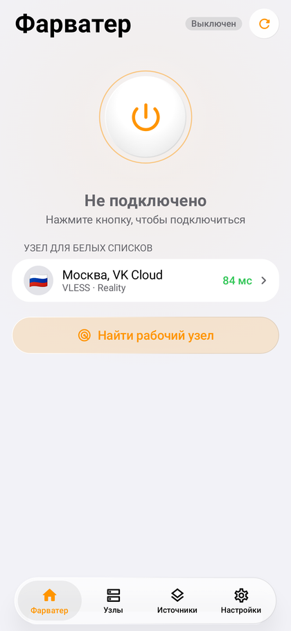</a><br><strong>iOS 26</strong></td>
<td width="33%" align="center" valign="top"><a href="docs/screens/material_home_light.png">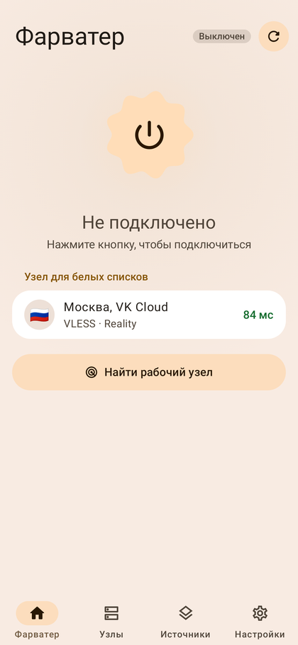</a><br><strong>Material You</strong></td>
<td width="33%" align="center" valign="top"><a href="docs/screens/rkp_home.png">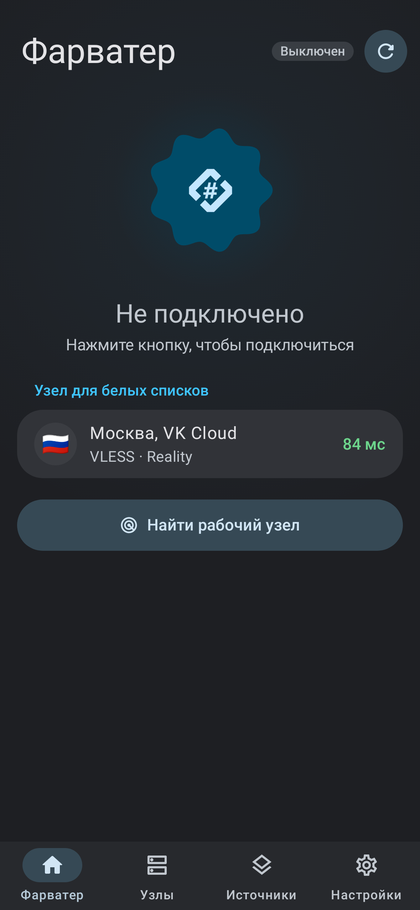</a><br><strong>#РосКомПозор</strong></td>
</tr>
<tr>
<td width="33%" align="center" valign="top"><a href="docs/screens/sumie_home.png">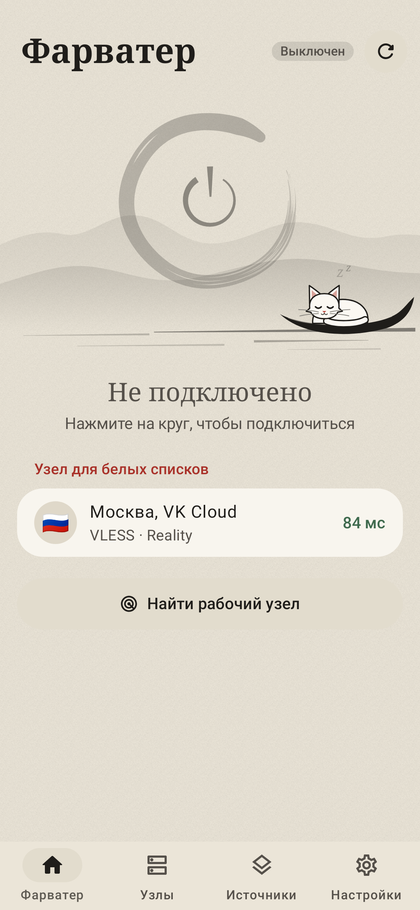</a><br><strong>Сумиэ</strong></td>
<td width="33%" align="center" valign="top"><a href="docs/screens/nothing_home.png">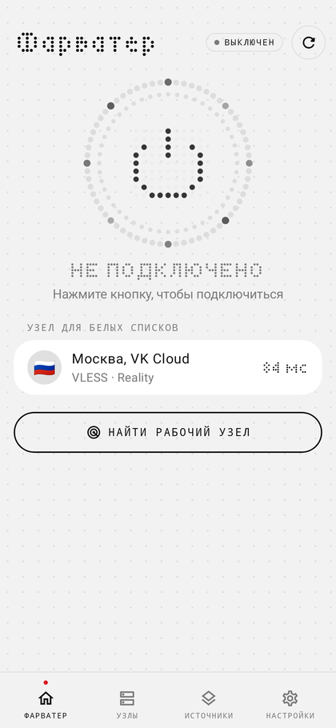</a><br><strong>Nothing</strong></td>
<td width="33%" align="center" valign="top"><a href="docs/screens/origin_home.png">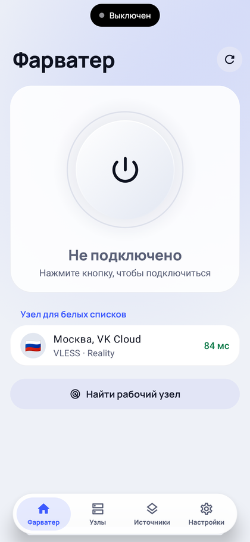</a><br><strong>Origin</strong></td>
</tr>
<tr>
<td width="33%" align="center" valign="top"><a href="docs/screens/hyper_home.png">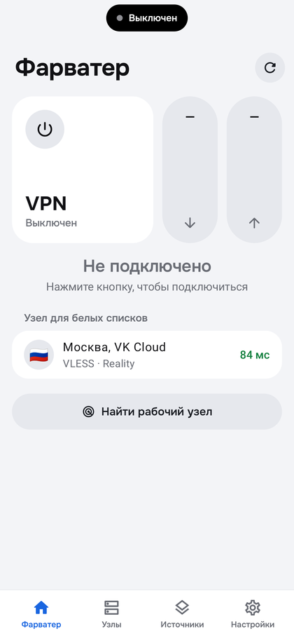</a><br><strong>Hyper</strong></td>
<td width="33%" align="center" valign="top"><a href="docs/screens/harmony_home.png">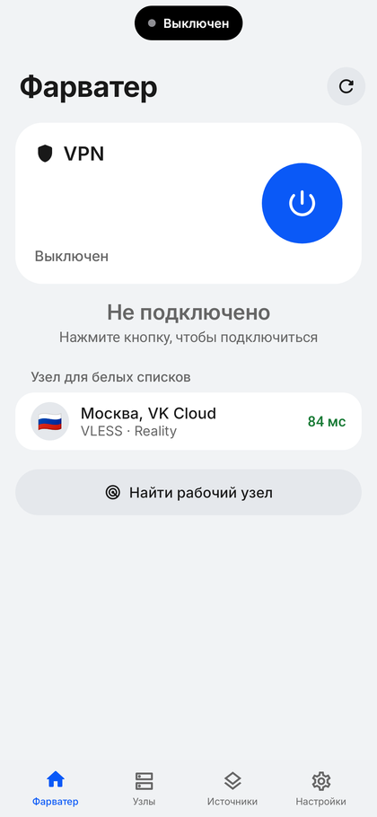</a><br><strong>Harmony</strong></td>
<td width="33%" align="center" valign="top"><a href="docs/screens/oneui_home.png">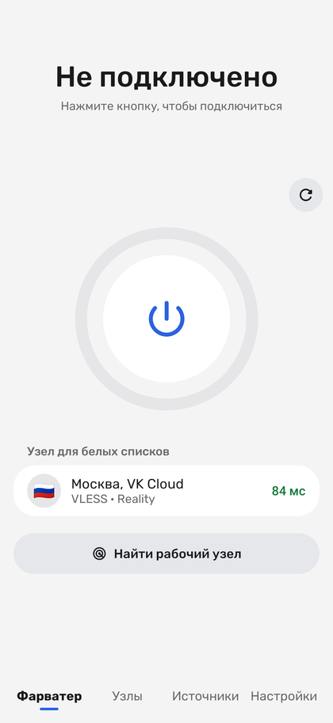</a><br><strong>One UI</strong></td>
</tr>
<tr>
<td width="33%" align="center" valign="top"><a href="docs/screens/oxygen_home.png">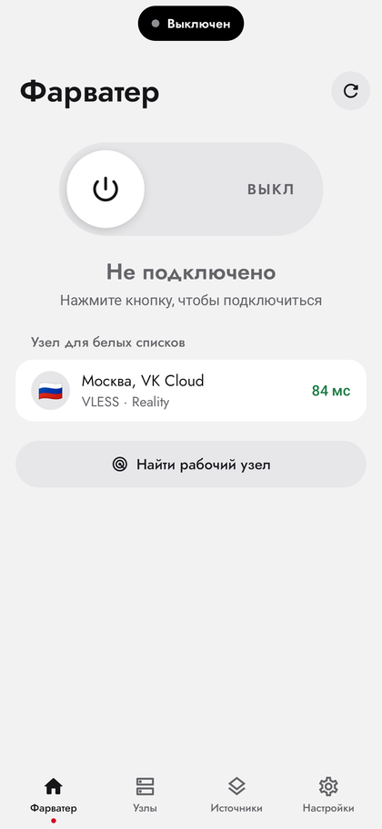</a><br><strong>Oxygen</strong></td>
<td width="33%" align="center" valign="top"><a href="docs/screens/witch_home.png">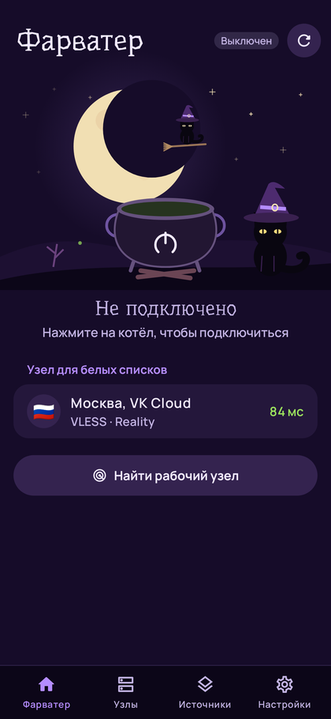</a><br><strong>Ведьмин кот</strong></td>
<td width="33%"></td>
</tr>
</table>

<sub>Снимки показывают интерфейс с демонстрационными данными. Названия узлов, задержки и скорость — примеры, а не предложение доступа или обещание результата.</sub>

### Ведьмин кот

Ночное небо, луна, кот на метле и котёл вместо обычной кнопки подключения. Сцена меняется вместе с состоянием VPN: ожидание, поиск, подключение, работа или ошибка. Это отдельный стиль в настройках, его можно выбрать и после праздника.

<table>
<tr>
<td align="center" width="25%"><br><strong>Тихая ночь</strong></td>
<td align="center" width="25%">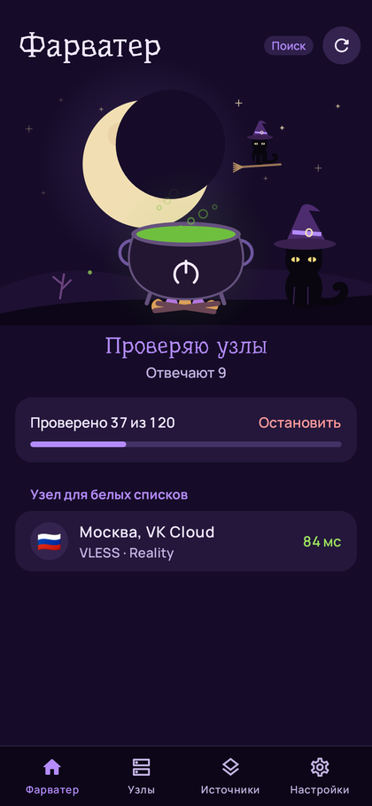<br><strong>Поиск узла</strong></td>
<td align="center" width="25%">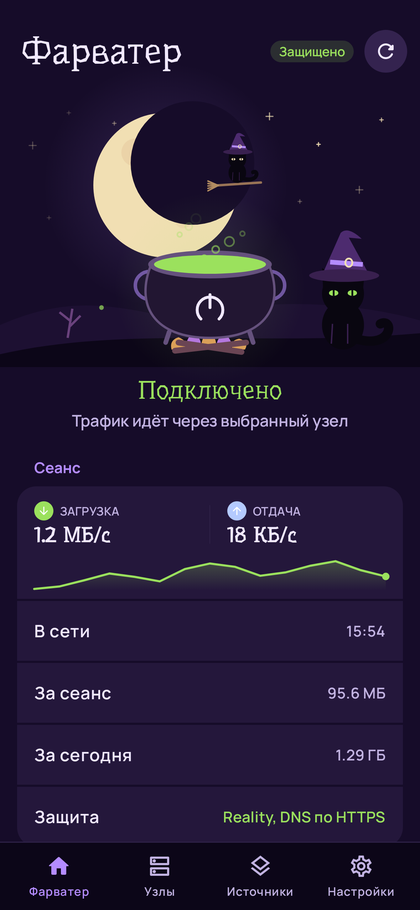<br><strong>Соединение</strong></td>
<td align="center" width="25%">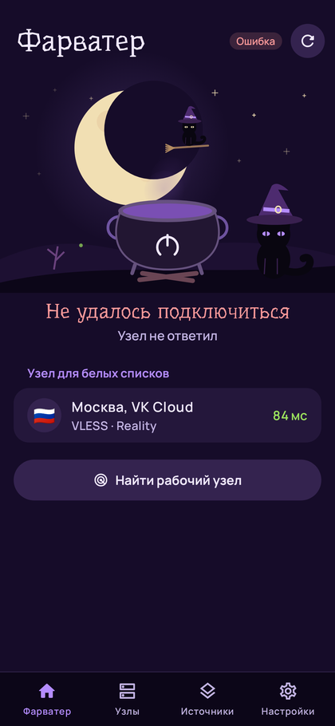<br><strong>Ошибка</strong></td>
</tr>
</table>

У кота есть короткое мурлыканье и отклик вибрацией. Звук не запускается в беззвучном режиме, в режиме вибрации и при нулевой громкости мультимедиа; сворачивание приложения останавливает воспроизведение. Если системные анимации выключены, сцена неподвижна. 31 октября и 1 ноября по дате телефона появляются полная луна и летучие мыши. У сидящего кота спрятана небольшая пасхалка — пять быстрых касаний.

### Шестнадцать значков

<p align="center"></p>

Классический · Ночь · День · Оранжевый · Голубой · Nothing · Сумиэ · Буква F · Origin · Hyper · Harmony · One UI · Oxygen · Тыква · Призрак · Ведьмин кот.

Значок выбирается отдельно от стиля. Изменение применяется после выхода из приложения. Вид маски значка зависит от оболочки Android; на отдельных телефонах ярлык на рабочем столе приходится заново добавить из списка приложений.

---

## Установка

**[Открыть последний выпуск и скачать APK](https://github.com/farvater-app/farvater/releases/latest)**

Нужен Android 8.0 или новее. Root не требуется. Официальные APK публикуются в выпусках этого репозитория; приложение этого проекта не распространяется через Google Play. Совпадение названия, значка или идентификатора пакета у приложения из другого источника не подтверждает его происхождение.

### Какой APK выбрать

В каждом выпуске есть пять вариантов. Все они содержат одно и то же приложение; отличаются набором нативных библиотек. В имени файла вместо `1.0.30` будет номер выбранного выпуска.

| Архитектура | Файл | Когда выбирать |
| :-- | :-- | :-- |
| **arm64-v8a** | `Farvater-1.0.30-arm64-v8a.apk` | Большинство современных телефонов и планшетов с 64-битным Android на ARM. |
| **armeabi-v7a** | `Farvater-1.0.30-armeabi-v7a.apk` | Устройства с 32-битным Android на ARM, в том числе с 64-битным процессором и 32-битной системой. |
| **x86_64** | `Farvater-1.0.30-x86_64.apk` | Устройства и эмуляторы с 64-битной системой x86. |
| **x86** | `Farvater-1.0.30-x86.apk` | Устройства и эмуляторы с 32-битной системой x86. |
| **universal** | `Farvater-1.0.30-universal.apk` | Если архитектура неизвестна: содержит библиотеки для всех четырёх вариантов, поэтому занимает больше места. |

Откройте скачанный файл. Если Android попросит разрешить установку из этого источника, дайте разрешение приложению, которым открываете APK. После установки это разрешение можно отозвать. Для самого VPN Android запросит отдельное согласие при первом подключении.

<details>
<summary><strong>Проверка подлинности и обновления</strong></summary>

**Сначала источник, затем подпись.** Скачивайте APK со [страницы выпусков](https://github.com/farvater-app/farvater/releases). `SHA256SUMS.txt` позволяет проверить, что файл совпадает с опубликованным. Контрольная сумма файла меняется между версиями и архитектурами; отпечаток сертификата подписи — другое значение.

SHA-256 сертификата официальной подписи:

```text
D8:80:FC:FE:51:D4:A3:06:A5:0F:B8:67:40:83:9D:74:75:37:53:D4:88:06:6B:27:E1:54:00:B5:42:BC:68:0F
```

На компьютере с Android SDK подпись можно проверить командой из Build Tools:

```sh
apksigner verify --print-certs Farvater-1.0.30-arm64-v8a.apk
```

Сравните `Signer #1 certificate SHA-256 digest` с отпечатком выше, не учитывая регистр и двоеточия. Успешная проверка подписи показывает целостность и подписанта APK; она не является аудитом серверов, к которым вы потом подключитесь.

**Обновление внутри приложения.** Автоматическая проверка новых версий включена по умолчанию. Фарватер получает описание выпуска, а скачивание и установка требуют вашего действия. Перед установкой проверяются SHA-256 файла, имя пакета, версия и совпадение подписи с установленным приложением. Саму установку выполняет Android. Проверку можно отключить в <kbd>Настройки</kbd> → <kbd>Обновления</kbd> и запускать вручную.

**Obtainium.** Можно добавить адрес `https://github.com/farvater-app/farvater` в [Obtainium](https://github.com/ImranR98/Obtainium): он следит за выпусками на GitHub. Его собственные настройки, разрешения и сетевые обращения определяются самим Obtainium.

**Если APK не устанавливается.** Проверьте версию Android, архитектуру, свободное место и источник установленной копии. Android не разрешит обновить приложение сборкой с другой подписью и может отклонить понижение версии. Не удаляйте текущую копию ради эксперимента, пока не сохранили адреса своих подписок: встроенной резервной копии настроек в 1.0.30 нет, удаление приложения может уничтожить локальные данные.

</details>

## Первый запуск

1. **Прочитайте документы.** На первом экране доступны условия использования и политика конфиденциальности. Продолжение подтверждает их принятие; разрешение VPN выдаётся отдельно.
2. **Выберите источники.** «Только мои подписки» оставит публичный каталог выключенным. «Включить публичные» включит ссылки на подписки сторонних авторов. Изменить выбор можно позже на вкладке «Источники».
3. **Добавьте свою подписку или узел.** На вкладке «Источники» используйте «Добавить подписку» либо «Вставить из буфера». Для подключения нужен хотя бы один доступный узел из выбранного источника.
4. **Выберите соединение.** На вкладке «Узлы» нажмите нужный сервер, затем кнопку подключения на главном экране. Если хотите проверить доступные варианты, запустите «Найти рабочий узел».
5. **Подтвердите запрос Android.** После выдачи разрешения системная служба создаст VPN. Состояние видно на главном экране и в уведомлении; выключить VPN можно той же основной кнопкой.

Зелёный статус соединения означает состояние приложения, а не гарантию доступности каждого сайта. Если соединение установлено, но нужное приложение не работает, проверьте узел, маршрут и исключения; подсказки собраны в [вопросах и ответах](#вопросы-и-ответы).

## Источники и узлы

Подписка — адрес, по которому загружается список серверов. Узел — одна конфигурация подключения. Публичный каталог — встроенный список ссылок на чужие подписки. Эти понятия разделены в интерфейсе: источники добавляются и обновляются на одной вкладке, а конкретный сервер выбирается на другой.

<details>
<summary><strong>Подписки, публичный каталог и обновление списков</strong></summary>

**Мои подписки.** Добавьте HTTP- или HTTPS-ссылку, полученную от владельца сервера или панели. Для защиты адреса и ответа при загрузке предпочтителен HTTPS. В адресе может находиться секрет доступа, поэтому не публикуйте его в обсуждениях, скриншотах и отчётах об ошибках.

Фарватер понимает списки ссылок, Base64 и поддерживаемые конфигурации Xray JSON. Для поддерживаемых адресов панелей он пробует JSON-вариант подписки, а если получить его не удалось — обычный. Отсутствие отдельного названия панели в интерфейсе не мешает импорту подходящего формата; совместимость с любым форматом любой панели не обещается.

Название, объявление, расход, лимит и срок действия показываются, если источник передал их в поддерживаемых заголовках или содержимом подписки. Это сведения поставщика, а не проверенный Фарватером платёжный баланс. Если источник их не присылает, приложение не может восстановить их самостоятельно.

**Публичный каталог.** В 1.0.30 в нём восемь источников от пяти авторов: zieng2, whoahaow, РКП, KfWL и «Бункер Кота». У каждого источника есть переключатель; в карточке доступны сведения об авторе, режиме и обновлении. Каталог по умолчанию выключен. Его можно включить целиком, затем оставить только нужные источники.

Сами списки загружаются с сайтов авторов и их зеркал. Встроенный список ссылок не делает разработчика владельцем этих серверов. Узлы могут появляться, исчезать, менять параметры и условия доступа. Вопросы оплаты и доступа решаются с поставщиком, а не через Фарватер.

**Обновление.** Нажмите подписку, чтобы выбрать режим и интервал. Кнопка обновления на вкладке загружает списки повторно; для отдельного источника есть «Обновить сейчас». При ошибке смотрите состояние именно этого источника: доступность остальных не означает, что его адрес тоже доступен.

| Интервал | Поведение |
| :-- | :-- |
| Авто | Используется поддерживаемый интервал из подписки; если его нет — 6 часов. |
| Каждый час / 3 / 6 / 12 часов / сутки | Используется выбранный интервал обновления. Реальное выполнение зависит от работы приложения и сети. |
| Только вручную | Плановое обновление этого источника отключено; список обновляется по вашему действию. |

**HWID.** По умолчанию личным подпискам передаются случайный идентификатор установки, модель телефона и версия Android. Это помогает панелям учитывать устройство; идентификатор не вычисляется из IMEI, но позволяет узнавать одну установку при следующих запросах. Отправку можно выключить в <kbd>Настройки</kbd> → <kbd>Подписки</kbd>. Публичным источникам каталога эти заголовки не передаются. Выключение отправки не удаляет сведения, уже полученные владельцем вашей подписки.

</details>

<details>
<summary><strong>Ручные узлы, JSON и импорт по ссылке</strong></summary>

«Вставить из буфера» принимает ссылку на подписку, одну или несколько ссылок на узлы и поддерживаемое содержимое подписки. Для отдельных узлов используются схемы `vless://`, `vmess://`, `trojan://`, `ss://`, `hysteria2://` и `hy2://`. Можно вставить несколько строк сразу. Буфер читается по вашему нажатию; вставленная ссылка может содержать пароль или ключ доступа.

Ручные узлы не привязаны к обновлению публичного каталога. Долгое нажатие на строку узла открывает действия: проверку, копирование, передачу ссылки и, для ручного узла, удаление. Передача ссылки раскрывает получателю её содержимое. Это отличается от «Поделиться приложением», где передаётся только APK.

**Xray JSON.** Поддерживаются отдельные конфигурации и массивы конфигураций, в том числе поддерживаемые цепочки выходов и балансировка. Фарватер подготавливает их для своего подключения: наличие слова JSON не означает выполнение любого произвольного файла без изменений. Конфигурации других клиентов и неизвестные параметры могут оказаться несовместимыми.

Импортированные выходы проверяются на известные небезопасные параметры. Запросы отключить проверку TLS-сертификата не становятся разрешением игнорировать сертификат в ядре. При этом доверие к источнику всё равно необходимо: цепочки, отдельный канал загрузки XHTTP и поддерживаемые блоки собственных проверок ядра могут добавлять серверы и сетевые обращения.

Сайт или бот может предложить импорт подписки через ссылку:

```text
farvater://import?url=https%3A%2F%2Fexample.com%2Fsubscription
```

Значение `url` кодируется как параметр URI. Фарватер показывает предложение импорта, а добавление требует подтверждения. Домен `example.com` здесь — пример формата, не рабочая подписка. Не размещайте реальный секретный адрес в общедоступной ссылке.

</details>

<details>
<summary><strong>Проверка, группы, поиск и избранное</strong></summary>

Нажатие на строку выбирает узел; при уже включённом VPN выбор другого узла приводит к переподключению. Задержка рядом с названием — результат проверки, а не обещание постоянной скорости. Короткая TCP-проверка и запрос через ядро измеряют разные вещи: открытый порт ещё не подтверждает, что через узел проходит полезный трафик.

В настройках проверки можно выбрать служебный адрес, число параллельных проверок, сортировку во время проверки, скрытие неработающих узлов и удаление дублей из представления. Более высокая параллельность создаёт больше одновременных соединений и может мешать слабой сети. Начните с обычной скорости или выберите бережную.

Узлы, которые дважды подряд не ответили, могут собираться в отдельной группе «Не отвечают». Заголовки групп сворачиваются нажатием. Результаты не вечны: доступный вчера сервер может перестать работать, а временно недоступный — восстановиться. Перед выводом о качестве источника обновите список и повторите проверку.

**Избранное.** Звёздочка рядом с узлом добавляет его в избранные или убирает оттуда. Фильтр избранного работает вместе с текстовым поиском, поэтому пустой список может означать, что нет узлов, одновременно подходящих обоим условиям. Снимите фильтр или очистите строку поиска, чтобы вернуться к полному списку.

Избранное сохраняет идентификаторы узлов на телефоне. Оно не копирует сервер, не закрепляет параметры чужой подписки и не задаёт Галсу обязательный порядок выбора. Если поставщик заменил конфигурацию, новый узел может потребовать новой отметки.

</details>

## Галс и режимы сети

**«Найти рабочий узел»** запускает Галс: приложение оценивает сеть, проверяет доступные узлы и пробует соединения с передачей тестовых данных. На главном экране виден ход поиска; его можно остановить. Галс помогает подобрать соединение по текущим проверкам, но не гарантирует работу всех сайтов и приложений.

<details>
<summary><strong>Как выбирается узел и что происходит при сбое</strong></summary>

Сначала проверяется доступность сети и кандидатов из подходящих источников. Затем Галс пробует работу через узел: чтение небольшого тестового файла, доступность адреса Telegram и, при включённом зашифрованном DNS, DNS-проверку. Приложение не входит в аккаунт Telegram и не получает сообщения, контакты или номер телефона.

Если подходящий вариант найден, приложение подключается. Поиск может продолжиться, чтобы найти заметно более быстрый вариант. В алгоритме предусмотрен запасной выбор по частичным результатам, поэтому сам факт подключения после поиска не означает, что каждый этап проверки обязательно завершился успешно. Ориентируйтесь на показанное состояние и работу нужного вам приложения.

Поиск расходует трафик. Одна попытка чтения тестового содержимого ограничена примерно 256 КиБ, но проверок, узлов и попыток может быть несколько. Итоговый расход включает соединения и протокольные накладные расходы; это не предел на весь поиск.

**Переключение при сбое** — отдельная настройка, включённая по умолчанию. Приложение сохраняет запасные узлы из результатов проверки. При повторных неудачах действующего соединения оно проверяет кандидатов и может перейти на работающий, учитывая принадлежность к текущему источнику. Переключения ограничены по частоте: не чаще одного раза в две минуты. Если запасных узлов нет или они тоже недоступны, настройка не создаст новый рабочий сервер.

Обычный цикл фоновых проверок активного узла работает при включённом экране; после подключения предусмотрены ранние проверки, при неудачах — более частые. Погашенный экран приостанавливает этот цикл, но не выключает VPN и не отменяет остальные фоновые задачи Android. При смене сети свойства соединения могут измениться даже без смены самого узла.

</details>

<details>
<summary><strong>БС, ЧС и автоматическое определение</strong></summary>

Режим на вкладке «Источники» помогает выбрать подходящие списки узлов. Это техническая оценка доступности сети, а не точное описание правил оператора или юридического статуса сайтов.

| Режим | Значение в приложении | Что меняется |
| :-- | :-- | :-- |
| **БС** | Белые списки: доступна ограниченная часть проверяемых адресов. | Используются источники, отмеченные для этого режима, и ваши источники с режимом «Оба». |
| **ЧС** | Обычные ограничения: часть внешних проверок проходит. | Используются источники ЧС и ваши источники с режимом «Оба». |
| **Авто** | Приложение оценивает доступность служебными запросами. | Подбирается режим, а при включённой настройке отдельных узлов — сохранённый узел для него. |

Свои подписки по умолчанию подходят обоим режимам. Назначение можно изменить в карточке источника. Источники, не подходящие текущему режиму, не участвуют в обычном выборе кандидатов; вручную выбранный режим не исправляет доступность самих серверов.

Для оценки Фарватер делает прямые запросы, мимо своего VPN, к нескольким служебным сайтам. Он пробует получить начальную часть файла; если нужного объёма нет, использует короткие проверки других адресов. Кратковременный сбой, фильтрация отдельного сайта или нестабильная сеть могут повлиять на результат. Если оценка не подходит вашей сети, выберите режим вручную.

При ручном выборе обычное автоматическое определение ограничивается. Однако Галс отдельно проверяет сеть перед поиском; ручной режим не является переключателем полного запрета прямых запросов. Перечень адресов и назначение этих обращений приведены в [политике конфиденциальности](legal/privacy.txt).

Настройка «Свой узел для БС и ЧС» позволяет помнить отдельный выбор для каждого режима и переключаться при изменении определённого режима. Это удобно, когда у вас разные подходящие серверы для разных сетей. Если такой подход не нужен, настройку можно выключить и выбирать узел самостоятельно.

</details>

## На каждый день

### История трафика

График расхода VPN за **7 или 30 дней** доступен в настройках. История остаётся на телефоне и не содержит адресов посещённых сайтов.

<details>
<summary><strong>Что учитывает история и как долго хранятся записи</strong></summary>

В <kbd>Настройки</kbd> → <kbd>История трафика</kbd> есть график за **7 или 30 дней**. На телефоне хранится до 60 суточных записей: дата и суммарный объём загрузки и отдачи через VPN. Адресов сайтов, сообщений и содержимого файлов в этой истории нет.

История использует дату телефона, не восстанавливает расход до начала его записи и может отличаться от учёта оператора. Это оценка трафика VPN, а не общий счётчик мобильного тарифа и не статистика каждого приложения. Записи за пределами последних 60 дней убираются при чтении или сохранении истории.

</details>

### Поделиться приложением

Передайте установленный APK через системное меню: **без ваших подписок и настроек, без новой копии в кэше Фарватера**. Подготовка файла не требует интернета.

<details>
<summary><strong>Как передаётся APK и кому он подойдёт</strong></summary>

Откройте <kbd>Настройки</kbd> → <kbd>Поделиться приложением</kbd> и выберите получателя в системном меню. Фарватер передаст **установленный APK**, без ваших подписок, избранного и настроек. Для этого открывается сам установочный файл только для чтения; новая копия в кэше Фарватера не создаётся.

Подготовка файла не требует интернета. Отправка зависит от выбранного приложения: оно может использовать сеть и сохранить собственную копию. APK содержит архитектуры установленной сборки, поэтому на другом устройстве может не подойти. Для установки, состоящей из нескольких APK, эта функция недоступна.

</details>

<details>
<summary><strong>Плитка, виджет и автоматическое подключение</strong></summary>

**Плитка шторки.** Добавьте плитку Фарватера через редактор быстрых настроек Android. Она позволяет включать и выключать подключение без перехода по вкладкам приложения. Для работы нужен выбранный узел; если ещё нет разрешения VPN или не закончено знакомство с приложением, может потребоваться открыть Фарватер и завершить настройку.

**Виджет.** Добавьте виджет Фарватера на рабочий стол средствами вашей оболочки. Он показывает состояние и позволяет управлять соединением. Размещение, масштаб и порядок добавления зависят от лаунчера; виджет не заменяет первоначальный выбор подписки и системное разрешение VPN.

**Автоподключение Фарватера** по умолчанию выключено. Его можно включить в разделе «Подключение»: после включения телефона приложение использует последний сохранённый узел, если необходимые разрешения уже выданы. После обновления оно может восстановить подключение, которое было включено до обновления. Работа зависит от системных ограничений и наличия сети.

**Постоянный VPN Android** настраивается отдельно в системных настройках. Он может запускать Фарватер по правилам Android независимо от переключателя автоподключения внутри приложения. Системная опция блокировки соединений без VPN также относится к Android; поведение с исключениями и на разных прошивках следует проверять на своём устройстве.

**Фоновая работа.** Раздел «Работа в фоне» показывает ограничения батареи и открывает страницу приложения в системе. Если прошивка завершает службу, проверьте эти ограничения. Уведомление и настройка батареи помогают управлять работой, но не гарантируют, что система никогда не остановит процесс.

</details>

### Языки и доступность

**Русский, английский и персидский**, подписи действий для TalkBack и учёт отключённых системных анимаций. Язык выбирается в настройках отдельно от оформления.

<details>
<summary><strong>Выбор языка, TalkBack и системные настройки</strong></summary>

В <kbd>Настройки</kbd> → <kbd>Язык</kbd> доступны **русский, английский, персидский** и выбор по системе. На Android 13 и новее используется системный механизм языков приложений; на более старых версиях выбор хранится в Фарватере. Персидский интерфейс учитывает направление справа налево. Юридические документы версии 1.0.30 остаются на русском.

Для TalkBack предусмотрены подписи действий и объявления изменения состояния подключения; свёрнутые группы узлов сообщают своё состояние. Интерфейс учитывает системное отключение анимаций. Отдельные значки и оформление помогают различать состояния, а текст остаётся основным источником их значения. Поведение озвучивания и увеличенного шрифта может различаться между версиями Android и службами доступности; о конкретной проблеме можно сообщить с названием экрана и версией системы.

</details>

---

<details>
<summary><strong>Ещё три экрана: избранное, расход и персидский интерфейс</strong></summary>

<table>
<tr>
<td width="33%" align="center">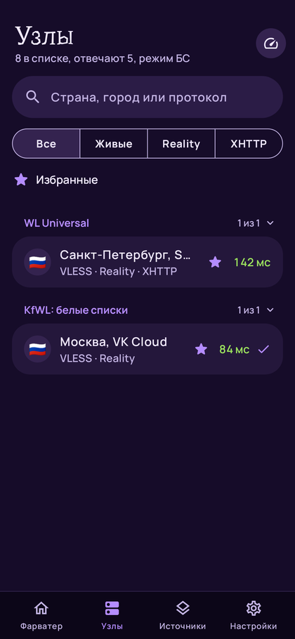<br><strong>Избранное</strong></td>
<td width="33%" align="center">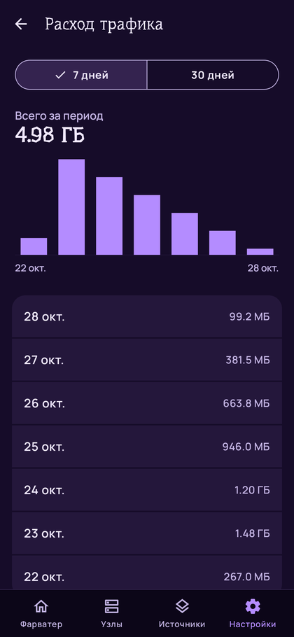<br><strong>История трафика</strong></td>
<td width="33%" align="center">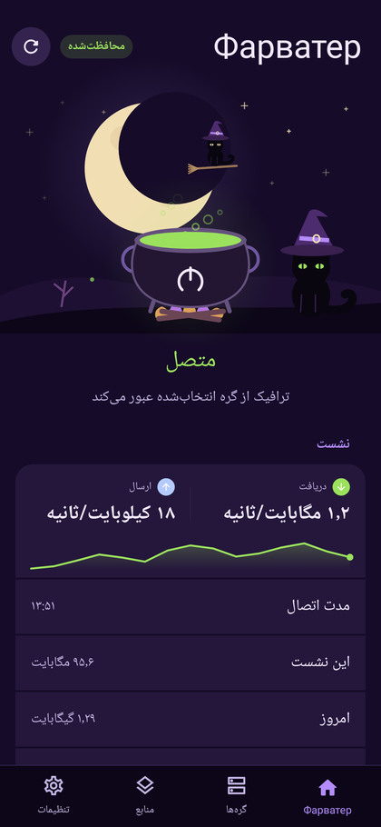<br><strong>Персидский</strong></td>
</tr>
</table>

</details>

## Справочник настроек

Значения ниже относятся к новой установке 1.0.30. При обновлении сохраняется ваш прежний выбор. Стиль оформления меняет внешний вид разделов, но не значения настроек подключения.

<details>
<summary><strong>Все настройки: оформление, соединение, безопасность и проверка</strong></summary>

| Где | Параметр | Начальное значение | Назначение |
| :-- | :-- | :-- | :-- |
| Оформление | Стиль | iOS 26 | Один из 11 вариантов оформления всего приложения. |
| Оформление | Тема | Как в системе | Светлая, тёмная или системная. У #РосКомПозор и «Ведьмина кота» только тёмное оформление. |
| Оформление | Цвета обоев | Включены | Динамическая палитра Material You на Android 12 и новее. |
| Оформление | Значок приложения | Классический | Один из 16 значков. Применяется после выхода из приложения; стиль при этом не меняется. |
| Язык | Язык интерфейса | По системе | Русский, английский, персидский либо системный выбор. Если среди системных языков нет поддерживаемого, используется русский. |
| Подключение | Российские сервисы | Включены | Домены из встроенного списка идут напрямую, а приложения из отдельного списка исключаются из VPN целиком. Они могут видеть обычный внешний IP-адрес. |
| Подключение | Приложения мимо VPN | Нет выбранных | Дополнительные приложения, которым нужен прямой доступ. Не отменяет встроенные исключения выше. |
| Подключение | Свой узел для БС и ЧС | Включено | Сохраняет отдельный узел для каждого режима и использует его при смене режима. |
| Подключение | Переключаться на рабочий узел | Включено | Проверяет запасные узлы при сбое и может сменить сервер. Зависит от наличия работающих кандидатов. |
| Подключение | Автоподключение | Выключено | Запуск с последним узлом после включения телефона; после обновления — восстановление ранее включённого VPN. Требует разрешения VPN. |
| Подключение | Постоянный VPN в Android | Настройка системы | Открывает системные настройки VPN. Это отдельный от автоподключения механизм Android. |
| Подключение | MTU | 8500 | Размер пакета в туннеле: 8500, 1500, 1480, 1400 или 1280. При проблемах отдельных приложений можно проверить меньший размер. |
| Безопасность | Только защищённые узлы | Включено | Скрывает в публичных подписках известные небезопасные конфигурации: без шифрования, с устаревшим шифрованием или запросом отключения проверки сертификата без закрепления. Не является аудитом сервера; ваши источники обрабатываются иначе. |
| Безопасность | Зашифрованный DNS | Включён | Использует поддерживаемые DNS-запросы через DNS по HTTPS. Не управляет всеми DNS-запросами системы и приложений вне VPN. |
| Подписки | Отправлять HWID | Включено | Передаёт личным подпискам случайный идентификатор установки, модель и версию Android. Каталог эти заголовки не получает. |
| Подписки | HWID | Создаётся локально | Показывает идентификатор и позволяет скопировать его. Это не IMEI и не серийный номер телефона. |
| Проверка узлов | Группа «Не отвечают» | Включена | Объединяет узлы после двух последовательных неудач в отдельную сворачиваемую группу. |
| Проверка узлов | Скрывать неработающие | Выключено | Убирает из отображаемого списка узлы без ответа. Если список пуст, проверьте этот фильтр. |
| Проверка узлов | Сортировать во время проверки | Выключено | Перестраивает порядок по результатам прямо во время проверки. |
| Проверка узлов | Убирать дубли | Выключено | Для обычных ссылок оставляет один узел для одинаковых адреса, порта и протокола; JSON-узлы различаются по идентификатору. Различия в SNI, ключах и других параметрах при таком объединении не сохраняют отдельную строку; выбранный узел имеет приоритет. |
| Проверка узлов | Адрес проверки | Google | Google, Cloudflare, Apple или Firefox. Служебный запрос через узел проверяет доступность выбранного адреса. |
| Проверка узлов | Скорость проверки | Обычно | Бережно — 8, обычно — 16, быстро — 32 одновременные проверки. Дополнительные ограничения уменьшают нагрузку на один адрес и SNI. |
| Работа в фоне | Ограничения батареи | Определяет Android | Показывает состояние ограничений и предлагает открыть системную страницу приложения. |
| Обновления | Проверять автоматически | Включено | Проверяет наличие версии при предусмотренных событиях и фоновой задачей с интервалом 15 минут. Фактическое время зависит от Android, сети и батареи. |
| Обновления | Проверить сейчас | Действие | Запускает ручную проверку; установка найденного APK требует вашего действия. |
| История трафика | Период графика | 7 дней | Переключает представление между 7 и 30 днями, не меняя состав хранимых суточных записей. |
| Поделиться приложением | Передать APK | Действие | Открывает системное меню передачи установленного файла. Показывает архитектуры сборки. |
| История изменений | Список изменений | Просмотр | Показывает историю версий из документа приложения. |
| Документы | Условия, политика, лицензии | Просмотр | Открывает включённые в приложение документы. В 1.0.30 они на русском. |
| О приложении | Версия и ссылки | Просмотр | Сведения о Фарватере и переходы к ресурсам проекта. |

Полные копии узлов с разными названиями могут объединяться при разборе подписки и без дополнительного переключателя «Убирать дубли». Для обычных ссылок эта настройка решает более широкую задачу: объединяет варианты одного адреса, порта и протокола. JSON-узлы при таком объединении различаются по идентификатору. Если важны разные настройки одного сервера, оставьте её выключенной.

**Параметры вне экрана настроек**

| Где | Параметр | Начальное значение | Назначение |
| :-- | :-- | :-- | :-- |
| Источники | Режим сети | Авто | Автоматическая оценка, БС или ЧС; влияет на выбор подходящих источников. |
| Источники | Публичные подписки | Выключены | Включает каталог; этот выбор также предлагается при первом запуске. |
| Источники | Выбор источников каталога | Все источники выбраны внутри выключенного каталога | Позволяет отключать отдельные списки. Когда в каталог добавляется новый источник, он включается в список выбранных; общий переключатель каталога сохраняется. |
| Карточка подписки | Режим | У публичной — из каталога; у своей — оба | Назначает источник одному или обоим режимам сети. |
| Карточка подписки | Обновлять | Авто | Интервал из подписки либо 6 часов; доступны свои интервалы и ручной режим. |
| Карточка подписки | Обновить сейчас | Действие | Повторно загружает выбранный источник. |
| Узлы | Избранное | Нет отметок | Сохраняет отмеченные звёздочкой узлы; фильтр помогает показать только их. |
| Узлы | Поиск | Пустая строка | Сужает отображаемый список и сочетается с фильтром избранного. |
| Узлы | Свёрнутые группы | Ваш выбор | Позволяет скрывать строки группы, сохраняя доступ к её заголовку. |

</details>

## Протоколы и форматы

Пять семейств протоколов: **VLESS, VMess, Trojan, Shadowsocks и Hysteria2**. Набор параметров зависит от протокола, формата ссылки и возможностей встроенного ядра. Поддержка протокола не означает, что любой сервер с таким названием будет совместим или безопасен.

<details>
<summary><strong>Таблица протоколов, транспортов и форматов импорта</strong></summary>

| Протокол | Поддерживаемые варианты | Что учитывать |
| :-- | :-- | :-- |
| VLESS | TCP / RAW, WebSocket, gRPC, HTTPUpgrade, XHTTP; TLS и Reality | Без TLS или Reality конфигурация может не шифровать транспорт. Нужны согласованные с сервером параметры, включая ключи и имя сервера, когда они используются. |
| VMess | TCP, WebSocket, gRPC, HTTPUpgrade, XHTTP; TLS при соответствующей настройке | Режимы `none` и `zero` отмечаются как отсутствие шифрования. Ссылка VMess разбирается из её Base64-представления. |
| Trojan | TCP, WebSocket, gRPC, HTTPUpgrade, XHTTP; TLS | Явное `security=none` отмечается как отсутствие шифрования. Проверка сертификата не отключается по запросу ссылки. |
| Shadowsocks | Соединения через выход Shadowsocks; AEAD и Shadowsocks 2022 | Поддерживается формат `ss://`. Неизвестный или устаревший шифр может быть отмечен как небезопасный либо не поддерживаться ядром. Плагины других клиентов автоматически не устанавливаются. |
| Hysteria2 | QUIC, TLS, смена портов; обфускация Salamander | Схемы `hysteria2://` и `hy2://`; возможен закреплённый сертификат. Доступность зависит в том числе от UDP в используемой сети. |

**Транспорт** описывает способ обмена с сервером, **протокол** — формат прокси-соединения, **TLS / Reality** — связанные с защитой параметры. Наличие транспорта WebSocket или gRPC само по себе не заменяет шифрование. XHTTP также может задавать отдельный канал загрузки, который нужно учитывать при оценке всей конфигурации.

Для TCP / RAW поддерживаются предусмотренные кодом параметры HTTP-заголовка; для WebSocket и HTTPUpgrade — путь и Host; для gRPC — имя сервиса и поддерживаемые параметры режима; для XHTTP — путь, режим и дополнительные параметры. Это описание импорта существующего узла, а не инструкция по настройке чужого сервера. Значения должен предоставить его владелец.

| Формат | Что принимает приложение |
| :-- | :-- |
| Одна ссылка | Поддерживаемая схема с параметрами одного узла. |
| Несколько ссылок | Список строк; комментарии и неподходящие строки не создают рабочие узлы. |
| Base64 | Поддерживаемое закодированное содержимое подписки, а не произвольный двоичный файл. |
| Xray JSON | Поддерживаемая конфигурация или массив; в том числе обработка цепочек и балансировки. Не всякая конфигурация другого клиента совместима. |
| HTTP(S)-подписка | Адрес, с которого загружается один из поддерживаемых форматов; метаданные показываются, когда источник их сообщает. |
| `farvater://import` | Предложение добавить URL подписки после подтверждения. |

**Сертификаты проверяются.** Флаги `insecure` и `allowInsecure` не используются как разрешение отключить проверку TLS в формируемом конфиге. Для поддерживаемых вариантов есть закрепление сертификата через `pinSHA256` или `pcs`. Если сертификат не подходит, изменение одной подписи в интерфейсе не делает соединение корректным: исправить параметры должен владелец сервера либо пользователь, располагающий доверенными данными.

**Границы импорта.** Приложение не включает редактор любого синтаксиса Xray и не обещает полной совместимости с форматами Clash, WireGuard, OpenVPN или произвольными VPN-профилями. Для неподдерживаемого формата попросите у поставщика подходящую ссылку или конфигурацию.

</details>

## Безопасность

Фарватер содержит меры защиты соединений и загрузки данных. Их смысл — уменьшить конкретные риски; они не превращают сторонний сервер в доверенный и не обещают анонимность.

**VPN не гарантирует анонимность, доступность всех сайтов и остановку всей сети при сбое.** По умолчанию включены прямые исключения для российских сервисов; часть служебных проб тоже выполняется напрямую. Защита зависит от параметров узла, маршрутов и самого телефона.

<details>
<summary><strong>Что защищено, исключения и пределы гарантий</strong></summary>

| Что предусмотрено | Где проходит граница |
| :-- | :-- |
| Проверка TLS-сертификатов; запросы отключить её не передаются как разрешение ядру. | Корректный сертификат не подтверждает добросовестность владельца узла. Не все поддерживаемые конфигурации используют шифрование. |
| Фильтр известных небезопасных узлов включён для публичных подписок. | Он не является аудитом и не применяется одинаково ко всем вашим источникам. Проверяйте параметры вручную добавленного узла. |
| Внутренний SOCKS-прокси слушает локальный адрес и использует случайный порт с паролем. | Это защита локального посредника, а не собственное шифрование всех файлов телефона. |
| При загрузке подписок отклоняются понижение HTTPS до HTTP и некоторые адреса самого устройства; заголовки устройства снимаются при смене хоста, схемы или порта. | Владелец исходного адреса получает запрос и его содержимое. HTTP-подписка изначально не защищена HTTPS. |
| Перед установкой обновления проверяются хэш, пакет, версия и подпись APK. | Проверка файла не заменяет доверия к исходной установленной сборке и безопасности Android. |
| Передача приложения открывает только собственный APK для чтения. | Выбранное приложение-получатель действует по своим правилам и может сохранить или переслать копию. |

**Что Фарватер не обещает.** Полное сокрытие личности, факта VPN, всех DNS-запросов и всех адресатов соединений; отсутствие журналов у сервера; гарантированную скорость и доступность сайтов; полную остановку сети при сбое VPN; сохранность данных на скомпрометированном или разблокированном телефоне. Вход в аккаунт сайта, cookies и поведение приложения могут идентифицировать вас независимо от выбранного узла.

По умолчанию включены прямые исключения для российских сервисов. Можно добавить свои приложения мимо VPN; локальные адреса имеют отдельное прямое правило. Такие соединения могут использовать обычный внешний IP-адрес. Исключение приложения из туннеля не скрывает от него сведения Android о включённом VPN.

Применимые права и пределы обязательств описаны в [условиях использования, редакция 2 от 30 октября 2026 года](legal/terms.txt). Права на код предоставляет GPL-3.0; пользовательские условия не отменяют их. Если обнаружили уязвимость, напишите на [injexor@proton.me](mailto:injexor@proton.me), не публикуя секретные ссылки и ключи; порядок сообщений также есть в [SECURITY.md](SECURITY.md).

</details>

## Конфиденциальность

**В приложении нет регистрации, рекламы, аналитики и автоматической отправки отчётов об ошибках.** Фарватер не отправляет разработчику вашу активность и не использует собственную сеть серверов для VPN-трафика. При этом работа с подписками, проверками, DNS и обновлениями создаёт настоящие обращения к сторонним сервисам.

На телефоне сохраняются настройки, подписки и ручные узлы, избранное, результаты проверок, параметры соединений и история расхода. Доступ к внутренним файлам ограничивается Android; отдельного пароля и собственного шифрования этих файлов у приложения нет. Автоматическое резервное копирование Android отключено, встроенного экспорта и восстановления в 1.0.30 нет.

<details>
<summary><strong>Кто получает запросы и какие данные остаются локально</strong></summary>

| Сценарий | Кто может получить запрос | Основные сведения |
| :-- | :-- | :-- |
| Обновление подписки | Её сайт и используемые зеркала | Адрес соединения, время, путь запроса, версия клиента; для личной подписки при включённом HWID — идентификатор установки, модель и версия Android. |
| Проверка узла | Сам узел и выбранный служебный сайт | Соединение от телефона к узлу и пробный запрос через него. Успешная проба не является проверкой политики ведения журналов. |
| Галс | Проверяемые узлы, сервисы тестовых данных, Telegram и при необходимости DNS-службы | Тестовые запросы, не содержимое вашего аккаунта Telegram. |
| Определение режима сети | Встроенные адреса сетевых проб | Прямое соединение и обычный внешний IP. Подписки, HWID и история посещений этим пробам не добавляются. |
| Проверка версии | GitHub, raw.githubusercontent.com, jsDelivr | Запрос описания выпуска с версией клиента. При неудаче через узел предусмотрена прямая попытка. |
| DNS | Используемая DNS-служба | Запрошенные доменные имена и адрес соответствующего соединения. Приложения и система могут иметь собственные механизмы DNS. |
| Обращение за помощью | Выбранный вами канал связи | Содержание отправленного сообщения и приложенных файлов. Автоматической отправки журналов нет. |

При активном VPN подписки загружаются через выбранный узел, без него — напрямую. Проверка обновлений может перейти к прямой попытке после неудачных попыток через узел. Определение режима сети изначально выполняется напрямую. Поэтому формулировка «все запросы приложения всегда внутри VPN» неверна.

JSON-конфигурация может содержать собственные проверки ядра и дополнительные адреса, в том числе в цепочке выходов и канале загрузки XHTTP. Встроенный перечень служебных сайтов не является исчерпывающим для произвольной импортированной конфигурации.

Список приложений нужен локально для выбора исключений. В историю трафика входят дата и общий объём VPN за день, а не посещённые сайты. В системном журнале Android могут быть технические ошибки и адреса серверов; перед самостоятельной отправкой журнала уберите приватные сведения.

Удаление приложения или очистка его данных может убрать настройки и подписки без возможности восстановления средствами Фарватера. Отключение HWID или удаление локальных сведений не стирает уже полученные сторонними сервисами данные. Их хранение и удаление определяются правилами этих сервисов.

</details>

Полное описание получателей запросов, локального хранения, разрешений и обращений — в [политике конфиденциальности, редакция 4 от 30 октября 2026 года](legal/privacy.txt). Вопросы о приватных данных лучше отправлять [по почте](mailto:injexor@proton.me): issue на GitHub и сообщения в публичных обсуждениях видны другим людям.

## Вопросы и ответы

<details>
<summary><strong>Установка и начало работы</strong></summary>

**Нужна ли регистрация или оплата?**

Для Фарватера — нет. Приложение бесплатно и не создаёт аккаунт. У выбранного вами поставщика серверов могут быть собственная регистрация, оплата и ограничения; это отдельные отношения с ним.

**Какую сборку выбрать, если не знаю архитектуру?**

`universal` содержит библиотеки для четырёх поддерживаемых архитектур. Если известно, что на телефоне 64-битный Android ARM, можно взять меньший `arm64-v8a`. Разрядность процессора и установленной системы иногда различается, поэтому одного названия процессора недостаточно.

**Почему нет версии в Google Play?**

Официальное распространение этого проекта идёт через GitHub Releases. Приложение с похожим названием в магазине не становится официальным автоматически. Используйте ссылки этого README и при необходимости проверьте сертификат.

**Есть ли версия для iPhone?**

Этот репозиторий содержит приложение для Android. Стиль iOS 26 меняет внешний вид Android-приложения и не означает наличие сборки для iOS.

**После установки нет узлов. Это ошибка?**

В новой установке публичный каталог выключен, а собственные подписки ещё не добавлены. Добавьте источник или осознанно включите каталог. Затем проверьте выбранный режим сети, состояние обновления подписки и фильтры на вкладке «Узлы».

**Можно ли перенести настройки на другой телефон?**

В версии 1.0.30 нет встроенного экспорта и восстановления данных. Сохраните исходные адреса личных подписок безопасным способом и добавьте их на новом устройстве. «Поделиться приложением» передаёт APK, а не ваши настройки и серверы.

</details>

<details>
<summary><strong>Подписки, соединение и фоновая работа</strong></summary>

**В подписке меньше узлов, чем ожидалось.**

Проверьте режим источника, фильтр избранного, строку поиска, скрытие неработающих и объединение дублей. Для публичных подписок по умолчанию действует фильтр известных небезопасных конфигураций. Неподдерживаемый формат строки тоже может не превратиться в узел. Уточните формат у поставщика, не публикуя секретный URL.

**Проверка показывает задержку, но нужный сайт не открывается.**

TCP-проверка подтверждает доступность порта, а проверка через ядро — результат конкретного служебного запроса. Ни одна из них не гарантирует доступ ко всем назначениям. Проверьте другой узел, настройки DNS, маршрут нужного приложения и состояние самого сайта. При проблемах отдельных приложений также можно проверить меньший MTU.

**Галс выбрал сервер, но часть приложений не работает.**

Поиск оценивает несколько конкретных запросов и может использовать запасной выбор по частичным результатам. У сервера могут быть свои ограничения. Остановите поиск, выберите другой доверенный узел или проверьте его вручную; успешный поиск не заменяет проверку вашей задачи.

**Российское приложение всё ещё замечает VPN, хотя исключено.**

Исключение определяет маршрут трафика. Android всё ещё может сообщать приложениям о наличии VPN. Фарватер не обещает скрывать этот признак.

**Почему сервер сам сменился?**

Возможные причины — продолжающийся поиск Галса, включённое переключение при сбое или выбор отдельного узла после смены режима сети. Если нужен только ручной выбор, остановите поиск и проверьте эти настройки в разделе «Подключение».

**Телефон нагревается во время проверки большого списка.**

Проверка запускает реальные соединения и работу ядра. Выберите скорость «Бережно», сократите число включённых источников и дождитесь окончания текущей проверки. Повышенная параллельность не всегда ускоряет результат в слабой сети.

**VPN отключается при сворачивании или после блокировки экрана.**

Посмотрите «Работа в фоне» и ограничения приложения в Android. Оболочка может завершать службу из-за батареи или собственной политики фоновой работы. Учтите также недоступность сервера и смену сети. Само выключение экрана не является командой выключить VPN, но приостанавливает обычные проверки активного узла.

**Можно ли включать VPN после перезагрузки?**

Да: настройте узел, один раз выдайте системное разрешение и включите автоподключение. Отдельно существует постоянный VPN Android. Надёжность запуска зависит от системы, доступности сети и сохранённого узла; эти механизмы не отменяют ограничения прошивки.

**Что делать при ошибке сертификата?**

Проверьте дату телефона и получите правильные параметры у владельца сервера. Фарватер не отключает проверку сертификатов по флагу `allowInsecure`. Закрепление сертификата имеет смысл только при наличии доверенного значения от владельца, а не случайного отпечатка из сообщения об ошибке.

</details>

<details>
<summary><strong>Оформление, трафик, передача APK и помощь</strong></summary>

**«Ведьмин кот» исчезнет после Хэллоуина?**

В 1.0.30 стиль доступен в обычном списке оформления без ограничения по дате. От даты телефона зависят праздничная луна и летучие мыши, а не возможность выбрать стиль. Это описание текущей версии, а не обещание состава всех будущих выпусков.

**Почему кот не мурлычет?**

Проверьте режим звонка и громкость мультимедиа. При беззвучном режиме, режиме вибрации или нулевой громкости звук не запускается. Воспроизведение также зависит от готовности звука и активности экрана приложения; мурлыканье не заменяет текстовое состояние соединения.

**Почему значок не сменился сразу?**

Применение запланировано после выхода из приложения. Лаунчер может обновить ярлык с задержкой, а иногда его нужно заново добавить из списка приложений. Выбор стиля и значка независим.

**История трафика не совпадает с оператором.**

Она показывает учёт VPN в Фарватере, а оператор считает сетевой обмен по собственным правилам. Прямые исключения, накладные расходы и периоды без записи дают различия. История не подходит для точного контроля остатка тарифа.

**Отправленный APK не установился у другого человека.**

Передаётся именно установленная у вас сборка с её архитектурами. Она может не подходить получателю; предложите официальный выпуск с нужной архитектурой или `universal`. Также проверьте Android 8+, подпись уже установленной копии и версию. Передача split-установок самой функцией не поддерживается.

**Можно ли отправить APK без интернета?**

Фарватер готовит доступ к установленному файлу без скачивания. Дальнейшая передача зависит от приложения, выбранного в системном меню. Если оно поддерживает подходящий локальный способ обмена, скачивать APK заново не нужно; сетевое поведение получателя контролирует не Фарватер.

**Как предложить источник для каталога или попросить его убрать?**

Напишите через контакты проекта и укажите общедоступную страницу автора, основание обращения и нужное изменение. Не публикуйте секретную личную подписку. Добавление в каталог не означает, что разработчик берёт на себя управление серверами.

**Что приложить к сообщению об ошибке?**

Версию Фарватера и Android, название экрана, последовательность действий, ожидаемый и фактический результат. Для проблемы интерфейса полезны стиль, язык и масштаб шрифта. Перед отправкой снимка или журнала уберите ключи, пароли, адреса личных подписок и сведения других людей. Уязвимости и приватные данные отправляйте по почте.

</details>

## Для разработчиков

Kotlin, Jetpack Compose, системный `VpnService`, Xray-core и нативный TUN-мост. Исходники приложения находятся в `app/src/main/java/app/farvater`; публичные правила участия — в [CONTRIBUTING.md](CONTRIBUTING.md).

<details>
<summary><strong>Устройство приложения и версии компонентов</strong></summary>

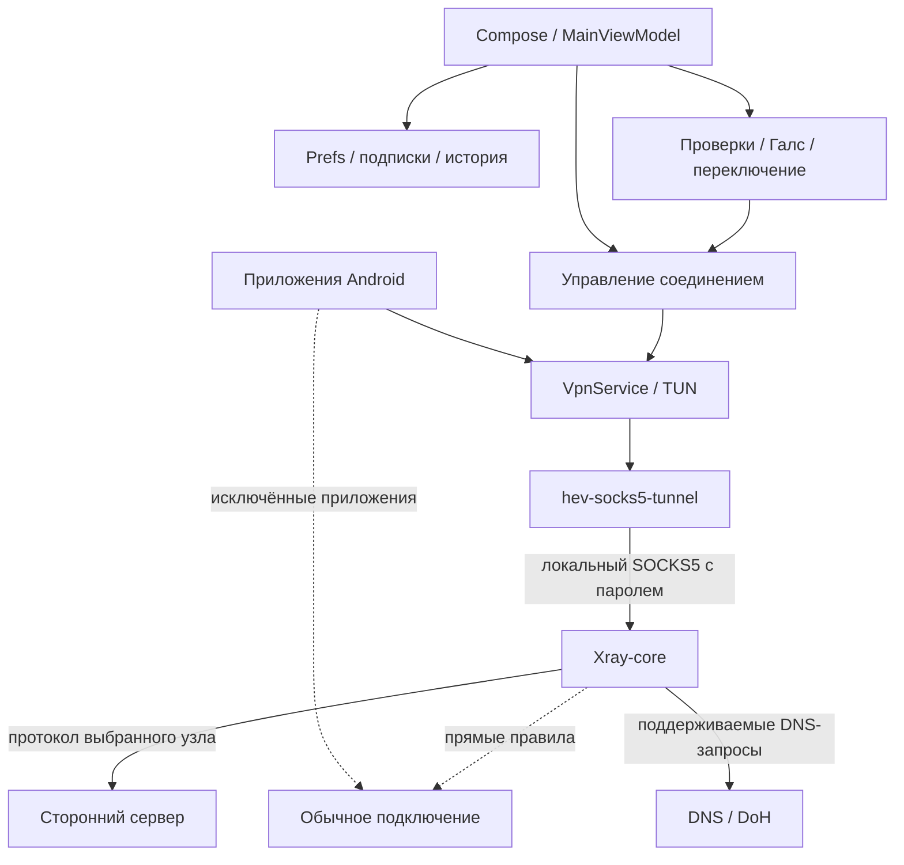

Android направляет в TUN трафик приложений, которые не исключены из VPN. Нативный мост превращает пакеты в обращения к локальному SOCKS-прокси. Xray применяет конфигурацию узла и правила маршрутизации. Сам Фарватер исключён из системного туннеля для предотвращения зацикливания; предусмотренные кодом запросы он явно направляет через локальный прокси, другие могут идти напрямую.

| Компонент | Версия в исходниках 1.0.30 | Источник значения |
| :-- | :-- | :-- |
| Xray / AndroidLibXrayLite | `v26.10.21` | `scripts/fetch-natives.sh` |
| hev-socks5-tunnel | `2.18.0` | `scripts/fetch-natives.sh` |
| Kotlin | `2.2.0` | `gradle/libs.versions.toml` |
| Jetpack Compose BOM | `2025.12.00` | `gradle/libs.versions.toml` |
| Android Gradle Plugin | `8.11.1` | `gradle/libs.versions.toml` |
| Gradle | `8.14.3` | `gradle/wrapper/gradle-wrapper.properties` |
| Java / JVM | `17` | `app/build.gradle.kts` |
| Android SDK | `minSdk 26`, `targetSdk 35`, `compileSdk 36` | `app/build.gradle.kts` |
| Android NDK для CI | `27.2.12479018` | `.github/workflows/release.yml` |
| OkHttp | `4.12.0` | `gradle/libs.versions.toml` |
| kotlinx.coroutines / serialization | `1.10.2` / `1.9.0` | `gradle/libs.versions.toml` |
| WorkManager | `2.10.1` | `gradle/libs.versions.toml` |
| Robolectric / Roborazzi | `4.17` / `1.76.0` | `gradle/libs.versions.toml` |

Версии нативных компонентов выше — значения по умолчанию скрипта. При самостоятельной сборке они могут быть переопределены переменными окружения; такая сборка требует собственной проверки совместимости.

| Каталог | Ответственность |
| :-- | :-- |
| `core/model` | Узлы, режимы и классификация известных параметров безопасности. |
| `core/parser` | Ссылки, подписки, Xray JSON, цепочки и балансировка. |
| `core/xray` | Конфигурация ядра и параметры локального прокси. |
| `core/catalog` | Встроенный список публичных подписок и исключений. |
| `engine` | Запуск ядра и моста, проверки узлов, Галс и переключение при сбое. |
| `vpn` | Служба VPN, автозапуск, плитка, виджет и команды подключения. |
| `data` | Локальные настройки, загрузка подписок, обновления, значки, языки и передача APK. |
| `ui` | Compose, ViewModel, экраны, компоненты и стили. |
| `legal` | Документы, включаемые в assets приложения. |
| `scripts` | Загрузка ядра, сборка нативного моста и подготовка данных выпуска. |

</details>

<details>
<summary><strong>Сборка, тесты и выпуск своей версии</strong></summary>

Понадобятся JDK 17, Android SDK с платформой 36, NDK `27.2.12479018`, Git и GitHub CLI для загрузки ядра. Настройте `ANDROID_SDK_ROOT` на установленный SDK. Отдельный Gradle не нужен: wrapper использует указанную в репозитории версию.

```sh
git clone https://github.com/farvater-app/farvater.git
cd farvater
export ANDROID_NDK_HOME="$ANDROID_SDK_ROOT/ndk/27.2.12479018"
./scripts/fetch-natives.sh
./gradlew :app:testDebugUnitTest :app:lintDebug :app:assembleDebug
```

Скрипт загружает `libv2ray.aar` из AndroidLibXrayLite, получает исходники hev-socks5-tunnel, применяет патч из репозитория и собирает мост для четырёх архитектур. Библиотеки располагаются в `app/libs` и `app/src/main/jniLibs`. Отсутствие этих файлов может не мешать компиляции интерфейса, но рабочее подключение без них невозможно.

Debug-APK находятся в `app/build/outputs/apk/debug/`. Они подписаны отладочным ключом и не предназначены для обновления официальной установленной копии. Не храните рабочие подписки и секреты в тестовых данных, исходниках и отчётах.

**Проверки.** `:app:testDebugUnitTest` запускает модульные и Robolectric-тесты: парсеры, безопасность конфигураций, поиск и переключение, сохранение состояния, оформление и другие сценарии. `:app:lintDebug` проверяет Android-код статически. `:app:recordRoborazziDebug` создаёт снимки Compose-интерфейса, включая стили и языки. Успешная компиляция и снимки не заменяют проверку VPN, системных разрешений, фоновой работы, передачи APK и TalkBack на настоящем устройстве.

**Release-APK без подписи**, если ключ не настроен:

```sh
./gradlew :app:assembleRelease -PfarvaterVersion=1.0.30
```

Для подписанной собственной сборки используйте `keystore.properties.example` как образец либо переменные `FARVATER_KEYSTORE`, `FARVATER_KEYSTORE_PASSWORD`, `FARVATER_KEY_ALIAS` и `FARVATER_KEY_PASSWORD`. Ключ и пароли не должны попадать в Git. Собственная подпись не совпадает с официальной; это отдельная сборка с собственным порядком распространения и обновления.

**Версия.** `farvaterVersion` задаёт `versionName`; без параметра используется `1.0.0`. Для обычной версии код рассчитывается как `MAJOR × 10000 + MINOR × 100 + PATCH`: у 1.0.30 это `10030`. Ветка логики для версии с суффиксом уменьшает код на единицу. При подготовке своих выпусков следите за возрастанием кода и совместимостью подписи.

**Автоматизация выпуска.** [release.yml](.github/workflows/release.yml) содержит сборку нативных компонентов, APK для четырёх архитектур и universal, подпись, контрольные суммы и публикацию данных обновления. Релиз запускается предусмотренным workflow тегом `vX.Y.Z` или веткой `release/vX.Y.Z`; нужны настроенные права и секреты вашего репозитория. Для своих сборок настройте собственный источник обновлений через `farvaterUpdateRepo`, а не выдавайте их за официальные APK проекта.

Описание пользовательских изменений ведётся в [CHANGELOG.md](CHANGELOG.md) и `release-notes.txt`. Строки заметок, начинающиеся с `- `, используются обновлятором; отметка `#critical` предназначена для важного обновления. Перед выпуском нужно проверить не только сборку, но и соответствие документов поведению приложения и комплектность лицензий.

**Особенность README.** Определение режима сети использует начальную часть публичного README как одну из проб и ожидает не менее 32 КиБ данных. Поэтому файл `README.md` в основной ветке должен оставаться **не меньше 40 КиБ**. При переводе или переработке документа проверьте размер в байтах, а не число символов; уменьшение файла может изменить результат этой сетевой пробы.

**Участие.** Начните с [CONTRIBUTING.md](CONTRIBUTING.md). Для воспроизводимой ошибки приложите шаги и версии окружения. Для изменения формата настроек учитывайте уже сохранённые данные, для изменения интерфейса — все затронутые стили, языки и доступность. Если меняются сетевые запросы или локальное хранение, описание в документах тоже должно быть актуальным.

</details>

## Благодарности

Фарватер опирается на работу авторов открытых проектов и публичных подписок.

| Проект | Авторы | Лицензия |
| :-- | :-- | :-- |
| [Xray-core](https://github.com/XTLS/Xray-core) | Project X | MPL-2.0 |
| [AndroidLibXrayLite](https://github.com/2dust/AndroidLibXrayLite) | 2dust | LGPL-3.0 |
| [hev-socks5-tunnel](https://github.com/heiher/hev-socks5-tunnel) | hev | MIT |
| [AndroidLiquidGlass](https://github.com/Kyant0/AndroidLiquidGlass) | Kyant | Apache-2.0 |

AndroidLiquidGlass подсказал подход к стеклянному оформлению: запись фона в слой, размытие и линза на AGSL. В Фарватере используется собственная реализация этого подхода.

Спасибо авторам публичных подписок, ссылки на которые включены в каталог: **[zieng2](https://github.com/zieng2/wl), [whoahaow](https://github.com/whoahaow/rjsxrd), [РКП](https://hub.mos.ru/rkp/sub-roskompozor), [KfWL](https://t.me/KfWLRus) и [Бункер Кота](https://t.me/BUNKER_KOTA)**. Их работа и правила использования источников самостоятельны; благодарность не означает передачи контроля над серверами разработчику Фарватера.

Логотип #РКП используется с разрешения РКП. Логотипы систем принадлежат их владельцам; стили не означают связи проекта с этими компаниями. Шрифты, библиотеки и звук мурлыканья имеют свои условия использования. Подробные уведомления, авторство и тексты требуемых лицензий находятся в [legal/licenses.txt](legal/licenses.txt) и доступны в приложении.

## Лицензия и связь

Код Фарватера распространяется по **[GNU GPL версии 3](LICENSE)**. Его можно изучать, изменять и распространять с соблюдением лицензии, включая требования к исходному коду и уведомлениям. GPL на код приложения не заменяет лицензии сторонних компонентов, звука, шрифтов и прав на товарные знаки.

| Куда обратиться | Ссылка |
| :-- | :-- |
| Исходники, выпуски и обсуждение ошибок | [farvater-app/farvater на GitHub](https://github.com/farvater-app/farvater) |
| Новости и обновления | [t.me/farvater_app](https://t.me/farvater_app) |
| Уязвимости, приватные данные и другие обращения | [injexor@proton.me](mailto:injexor@proton.me) |
| Условия использования | [Редакция 2](legal/terms.txt) |
| Политика конфиденциальности | [Редакция 4](legal/privacy.txt) |
| Сторонние материалы | [Лицензии и уведомления](legal/licenses.txt) |

Публичные страницы видны другим людям. Перед публикацией сообщения проверьте, что в нём нет паролей, ключей, секретных подписок и чужих персональных данных.

<details>
<summary><strong>In English</strong></summary>

**Farvater is a free, open-source VPN client for Android 8.0 and later.** It connects to servers you choose; it is not a VPN service and does not operate its own server network. There is no registration, advertising or analytics in the app. Third-party servers and subscription providers have their own terms and privacy practices.

It supports VLESS, VMess, Trojan, Shadowsocks and Hysteria2 through Xray-core, subscription lists, supported Xray JSON configurations and manual nodes. Features include connection checks, the Gals node search, failover, per-app exclusions, favourites, local traffic history, a Quick Settings tile, a widget and sharing the installed APK without including your subscriptions or settings.

Choose from 11 interface styles and 16 app icons. Russian, English and Persian are available; the legal documents included in version 1.0.30 remain in Russian. The interface includes TalkBack labels and connection-state announcements and respects disabled system animations.

**[Download an official APK](https://github.com/farvater-app/farvater/releases/latest)**. Choose `arm64-v8a` for most recent ARM Android devices, the matching ABI for other devices, or `universal` if unsure. VPN does not guarantee anonymity or the availability of any particular service. Routing exclusions and some service checks use direct connections. Read the [privacy policy](legal/privacy.txt), [terms](legal/terms.txt) and [GPL-3.0 licence](LICENSE).

</details>

---

<p align="center"><strong>Фарватер</strong><br><sub>Открытый код. Понятные настройки. Ваш выбор соединения.</sub></p>
